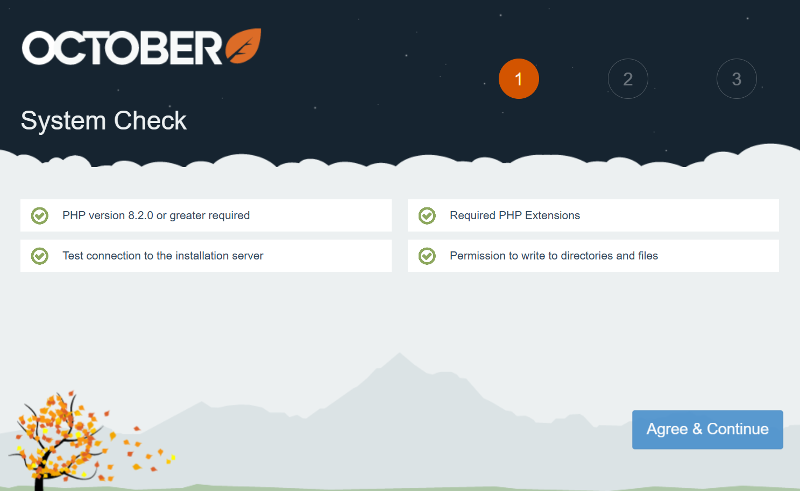

# Installation

<VideoBlockLink src="https://www.youtube.com/watch?v=RHUwCvo7xng" title="Installation Tutorial" description="This video describes how to create a project, purchase a license and install October CMS for the first time." prompt="Watch the tutorial" />

## Minimum System Requirements

Before installing October CMS, ensure the target system meets the minimum requirements:

* PHP version 8.2.0 or higher
* Composer 2.0 or higher
* PDO PHP Extension
* cURL PHP Extension
* OpenSSL PHP Extension
* Mbstring PHP Extension
* ZipArchive PHP Extension
* GD PHP Extension
* SimpleXML PHP Extension.

Supported database servers:

* MySQL 5.7 or MariaDB 10.2. For older versions of MySQL or MariaDB, you may need to [configure the index lengths](../setup/database-config.md#oc-index-lengths-using-mysql-mariadb) to support the utf8mb4 character set.
* PostgreSQL 9.6
* SQLite 3.8.8.

Supported web servers:

* Apache
* Nginx
* Lighttpd
* Microsoft IIS

## Installing October CMS

::: aside
You should configure a virtual host on the web server to access the installation directory. For local development you can use [DDEV, Laravel Sail or Laragon](#local-development-environments), [Valet](https://laravel.com/docs/valet) or the built-in Laravel development server.
:::

October CMS is a PHP web application that uses [Composer](http://getcomposer.org/) to manage its dependencies. Ensure that Composer is installed before you begin. The [License Key](https://octobercms.com/help/site/projects#project-id) will be required to complete the installation.

To install the platform, initialize a project using the `create-project` command in the terminal. The following command creates a new project in a directory called *myoctober*:

```bash
composer create-project october/october myoctober
```

When the command finishes, enter the project directory:

```bash
cd myoctober
```

Run the installation command:

```bash
php artisan october:install
```

The last step is the migration command that will initialize the database. Alternatively, October CMS can initialize the database when you first access the backend panel.

```bash
php artisan october:migrate
```

When the process finishes, you can access the backend panel in a browser and create the administrator user profile. If you are using the built-in web server, you can launch it with the following command:

```bash
php artisan serve
```

::: warning
If you are installing the platform on a production web server, review the recommendations listed in the [Production Configuration](../setup/configuration.md#production-configuration) article.
:::

## Local Development Environments

The following tutorials set up a local development environment for October CMS, including the web server, PHP and database.

- [Installing October CMS with DDEV](https://octobercms.com/support/article/installing-october-cms-with-ddev), a Docker-based environment that doesn't need PHP or Composer on your operating system.
- [Installing October CMS with Laravel Sail](https://octobercms.com/support/article/installing-october-cms-with-laravel-sail), the Docker-based environment from Laravel.
- [Installing October CMS with Laragon](https://octobercms.com/support/article/installing-october-cms-with-laragon), a local environment for Windows.

## Wizard Installation

<VideoBlockLink src="https://www.youtube.com/watch?v=ypyOiVCxaQg" title="Wizard Tutorial" description="This video guides you through the process of installing October CMS using the easy-to-use Wizard installer." prompt="Watch the tutorial" />

The wizard installation is an alternative way to install October CMS without using Composer. It is simpler than the command-line installation and doesn't require any special skills.

1. Prepare a directory on your server that is empty. It can be a sub-directory, domain root or a sub-domain.
1. [Download the installer archive file](https://octobercms.com/download).
1. Unpack the installer archive to the prepared directory.
1. Grant writing permissions on the installation directory and all its subdirectories and files.
1. Navigate to the `install.php` script in your web browser.
1. Follow the installation instructions.



## Troubleshooting Installation

The following articles explain how to resolve typical issues that can occur during or after installation.

- [Installation freezes after entering the license key](https://octobercms.com/support/article/installation-freezes-after-entering-the-license-key)
- [cURL error 60: unable to get local issuer certificate](https://octobercms.com/support/article/curl-error-60-unable-to-get-local-issuer-certificate)
- [Specified key was too long; max key length is 767 bytes](https://octobercms.com/support/article/specified-key-was-too-long-max-key-length-767-bytes)
- [Blank screen when opening the application](https://octobercms.com/support/article/blank-screen-when-opening-the-application)
- [Invalid security token error when logging in](https://octobercms.com/support/article/invalid-security-token-error-when-logging-in)
- [Backend panel displays "Page not found" (404)](https://octobercms.com/support/article/backend-panel-displays-page-not-found-404)
- [Error 500 when updating the application](https://octobercms.com/support/article/error-500-when-updating-the-application)
- [Zend OPcache API is restricted by "restrict_api" configuration directive](https://octobercms.com/support/article/zend-opcache-api-is-restricted-by-restrict-api)
- [Composer error: Invalid credentials (HTTP 403)](https://octobercms.com/support/article/composer-error-invalid-credentials-http-403)

More solutions are listed under [Known Errors](https://octobercms.com/support/articles/known-errors) in the Knowledge Base.

#### See Also

::: also
* [Production Configuration](../setup/configuration.md#production-configuration)
:::
