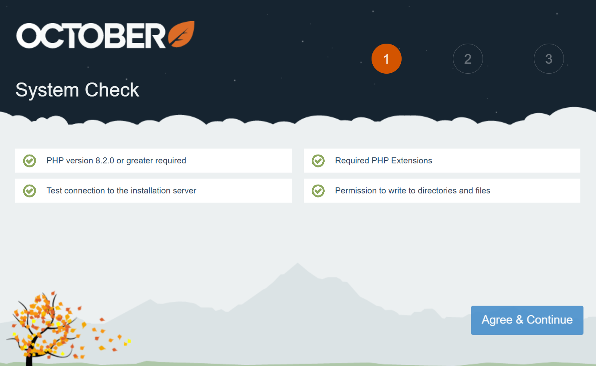

# Installation

October CMS is a PHP application that you install with Composer. Follow the steps on this page to go from an empty directory to a running website with a backend panel.

```bash
composer create-project october/october myoctober
cd myoctober
php artisan october:install
php artisan october:migrate
```

<VideoBlockLink src="https://www.youtube.com/watch?v=RHUwCvo7xng" title="Installation Tutorial" description="This video describes how to create a project, purchase a license and install October CMS for the first time." prompt="Watch the tutorial" />

## System Requirements

Check that your system meets these requirements before you begin.

* PHP version 8.2.0 or higher
* Composer 2.0 or higher
* PDO PHP Extension
* cURL PHP Extension
* OpenSSL PHP Extension
* Mbstring PHP Extension
* ZipArchive PHP Extension
* GD PHP Extension
* SimpleXML PHP Extension

Supported database servers:

* MySQL 5.7 or MariaDB 10.2. For older versions of MySQL or MariaDB, you may need to [configure the index lengths](./database.md#oc-index-lengths-using-mysql-mariadb) to support the utf8mb4 character set.
* PostgreSQL 9.6
* SQLite 3.8.8

Supported web servers:

* Apache
* Nginx
* Lighttpd
* Microsoft IIS

You also need a [License Key](https://octobercms.com/help/site/projects#project-id) to complete the installation.

## Installing with Composer

::: aside
Configure a virtual host on your web server that points to the installation directory. For local development you can use [DDEV, Laravel Sail or Laragon](#local-development-environments), [Valet](https://laravel.com/docs/valet) or the built-in Laravel development server.
:::

October CMS uses [Composer](http://getcomposer.org/) to manage its dependencies, so make sure Composer is installed first.

**1. Create the project.** The `create-project` command downloads October CMS into a new directory. This example uses a directory called *myoctober*.

```bash
composer create-project october/october myoctober
```

**2. Enter the project directory.**

```bash
cd myoctober
```

**3. Run the installer.** The installer asks for your language, application URL, backend URL, database connection, whether to install the demo theme, and your license key. It then installs the remaining dependencies.

```bash
php artisan october:install
```

**4. Migrate the database.** This command creates the database tables. You can skip it and let October CMS initialize the database when you first open the backend panel.

```bash
php artisan october:migrate
```

**5. Open the backend panel.** Visit the backend URL in your browser (`/admin` by default) and create the administrator account. If you don't have a web server set up, start the built-in one with this command.

```bash
php artisan serve
```

::: warning
If you are installing on a production web server, review the recommendations in [Production Configuration](./configuration.md#production-configuration).
:::

## Local Development Environments

These tutorials set up a local development environment for October CMS, including the web server, PHP and database.

- [Installing October CMS with DDEV](https://octobercms.com/support/article/installing-october-cms-with-ddev), a Docker-based environment that doesn't need PHP or Composer on your operating system.
- [Installing October CMS with Laravel Sail](https://octobercms.com/support/article/installing-october-cms-with-laravel-sail), the Docker-based environment from Laravel.
- [Installing October CMS with Laragon](https://octobercms.com/support/article/installing-october-cms-with-laragon), a local environment for Windows.

## Installing with the Wizard

<VideoBlockLink src="https://www.youtube.com/watch?v=ypyOiVCxaQg" title="Wizard Tutorial" description="This video guides you through installing October CMS with the Wizard installer." prompt="Watch the tutorial" />

The wizard installs October CMS from your browser, without Composer or the command line.

1. Prepare an empty directory on your server. It can be a subdirectory, the domain root or a subdomain.
1. [Download the installer archive file](https://octobercms.com/download).
1. Unpack the installer archive into the prepared directory.
1. Grant write permissions on the installation directory and all its subdirectories and files.
1. Open the `install.php` script in your web browser.
1. Follow the installation instructions.



## Troubleshooting Installation

These articles explain how to resolve the most common issues during or after installation.

- [Installation freezes after entering the license key](https://octobercms.com/support/article/installation-freezes-after-entering-the-license-key)
- [cURL error 60: unable to get local issuer certificate](https://octobercms.com/support/article/curl-error-60-unable-to-get-local-issuer-certificate)
- [Specified key was too long; max key length is 767 bytes](https://octobercms.com/support/article/specified-key-was-too-long-max-key-length-767-bytes)
- [Blank screen when opening the application](https://octobercms.com/support/article/blank-screen-when-opening-the-application)
- [Invalid security token error when logging in](https://octobercms.com/support/article/invalid-security-token-error-when-logging-in)
- [Backend panel displays "Page not found" (404)](https://octobercms.com/support/article/backend-panel-displays-page-not-found-404)
- [Error 500 when updating the application](https://octobercms.com/support/article/error-500-when-updating-the-application)
- [Zend OPcache API is restricted by "restrict_api" configuration directive](https://octobercms.com/support/article/zend-opcache-api-is-restricted-by-restrict-api)
- [Composer error: Invalid credentials (HTTP 403)](https://octobercms.com/support/article/composer-error-invalid-credentials-http-403)

More solutions are listed under [Known Errors](https://octobercms.com/support/articles/known-errors) in the Knowledge Base.

#### See Also

::: also
* [Production Configuration](./configuration.md#production-configuration)
* [Web Server Configuration](./web-server.md)
:::
